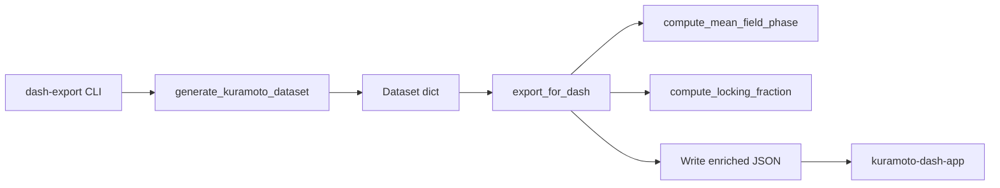

# Requirements

### Overview & Goals
Improve the data pipeline between the Kuramoto simulation suite and the `kuramoto-dash-app` (Plotly Dash dashboard). The goal is richer export data, a CLI subcommand for one-shot simulation-to-export, and a path toward file-based streaming — all without a massive refactor.

### Scope

**In Scope (Phase 1 — this plan):**
- New module `src/kuramoto/dash_export.py` with an enriched export function
- New metrics: mean field phase ψ(t), frequency locking fraction, network topology metadata, solver type and parameters
- New CLI subcommand `kuramoto dash-export` that runs a simulation and exports directly
- Tests for the new module
- Update `research/LEARNING_GUIDE.md` Section 8 with the enhanced protocol

**Out of Scope (deferred to future phases):**
- File-based streaming (`--stream` flag) — Phase 2
- Dash component template — Phase 3
- Bifurcation diagram support (`--sweep-k`) — Phase 4

### User Stories
- As a researcher, I want to run `kuramoto dash-export` and get a JSON file with all the metrics my Dash app needs, so I don't have to manually chain commands.
- As a researcher, I want the export to include ψ(t) and the locking fraction, so I can visualize synchronization dynamics beyond just R(t).
- As a researcher, I want solver and topology metadata in the export, so my Dash app can display how a simulation was configured.

### Functional Requirements
1. `export_for_dash(dataset, output_path, **kwargs)` — takes a dict from `generate_kuramoto_dataset()` and writes enriched JSON.
2. JSON format: `{"metadata": {...}, "data": {...}}` where `data` uses `orient='split'` (backward compatible with existing Dash app).
3. New fields in `data`: `mean_field_phase` (ψ(t)), `locking_fraction` (fraction of phase-locked oscillators per timestep).
4. New fields in `metadata`: `solver`, `topology_type`, `topology_stats`, `solver_params` (dt, noise, etc.).
5. CLI subcommand `kuramoto dash-export` accepts simulation parameters (or a config file) and an output path, runs the simulation, and exports.

### Non-Functional Requirements
- Changes are additive — existing `scripts/export_to_dash.py` continues to work.
- Follows project conventions: Black + Ruff formatting, NumPy docstrings, `if __name__ == "__main__": main()` with smoke tests.
- No new dependencies beyond what's already in `pyproject.toml` (numpy, scipy, networkx, click, pandas).

# Technical Design

### Current Implementation
- `scripts/export_to_dash.py` (78 lines): loads `.npz`, computes R(t), exports JSON with `orient='split'`. Metadata is minimal (n_oscillators, coupling, noise_std, solver from `.npz` attributes).
- `src/kuramoto/api.py`: `generate_kuramoto_dataset()` returns a dict with `theta`, `omega`, `dtheta`, `time`, `adjacency`, `network_stats`, `coupling`, `noise_std`, `freq_pdf`, `phase_pdf`, plus optional symmetry metrics.
- `src/kuramoto/order_parameter.py`: `compute_order_parameter()` returns R(t) magnitude. **No function exists for ψ(t) (mean field phase angle) or frequency locking fraction.**
- `src/kuramoto/cli/main.py`: Click group with 12 registered subcommands. New commands are added via `cli.add_command()`.
- `src/kuramoto/cli/commands.py`: Contains command implementations. The `generate` command (line 191) is the reference pattern — it accepts options, calls `generate_kuramoto_dataset()`, and saves `.npz`.

### Key Decisions
1. **New module `src/kuramoto/dash_export.py`** — keeps export logic importable, testable, and separate from the script. Follows the project's single-responsibility module pattern (e.g., `order_parameter.py`, `dataset.py`).
2. **ψ(t) computed as `angle(mean(exp(1j*theta)))`** — the mean field phase is the argument of the complex mean phasor. This is a one-liner derived from the same computation as R(t).
3. **Frequency locking fraction** — computed by checking if each oscillator's instantaneous frequency (via `np.gradient(theta, time, axis=0)`) is within a tolerance of the mean frequency. An oscillator is "locked" if its frequency deviation from the mean stays below a threshold over a sliding window.
4. **CLI follows the `generate` command pattern** — uses Click options, calls `generate_kuramoto_dataset()`, then calls `export_for_dash()`.

### Proposed Changes

**New file: `src/kuramoto/dash_export.py`**
- `compute_mean_field_phase(theta: NDArray) -> NDArray` — returns ψ(t), shape (T,).
- `compute_locking_fraction(theta: NDArray, time: NDArray, threshold: float = 0.1, window: int = 10) -> NDArray` — returns fraction of locked oscillators per timestep, shape (T,).
- `export_for_dash(dataset: Dict, output_path: str, include_locking: bool = True, **kwargs) -> None` — enriches the dataset dict with computed metrics and writes JSON.
- Smoke test + `main()` entry point.

**New file: `tests/test_dash_export.py`**
- Test that `export_for_dash` produces valid JSON with expected fields.
- Test `compute_mean_field_phase` returns values in [-π, π].
- Test `compute_locking_fraction` returns values in [0, 1].
- Test that perfectly synchronized phases yield locking fraction = 1.0.

**Modified: `src/kuramoto/cli/commands.py`**
- Add `dash_export` Click command with options: `--output`, `--oscillators`, `--coupling`, `--timesteps`, `--dt`, `--solver`, `--topology`, `--seed`, `--config`.
- Signature mirrors the `generate` command but defaults to simpler parameters.

**Modified: `src/kuramoto/cli/main.py`**
- Import and register `dash_export` command.
- Update smoke test to include `dash_export` in expected commands.

**Modified: `research/LEARNING_GUIDE.md`**
- Update Section 8 to document the enhanced JSON schema (new fields, new CLI command).

### Architecture Diagram

### Risks
- **Frequency locking threshold sensitivity**: The `threshold` and `window` parameters for locking fraction detection may need tuning. Default values (0.1 rad/s, 10 timesteps) are reasonable for typical simulations but may not work for all parameter regimes. Mitigation: expose as kwargs in `export_for_dash`.
- **Large adjacency matrices in JSON**: The adjacency matrix can be large for N > 100. Mitigation: store topology type and stats in metadata, but only include the full adjacency matrix if `--include-topology` is explicitly requested.

# Testing

### Validation Approach
Unit tests in `tests/test_dash_export.py` validate each function independently. A smoke test in `dash_export.py` validates the full pipeline end-to-end.

### Key Scenarios
1. **Mean field phase**: Perfectly synchronized phases (all θ = 0) should yield ψ(t) = 0. Uniformly distributed phases should yield ψ(t) near random.
2. **Locking fraction**: All oscillators with identical frequency → locking fraction = 1.0. Widely different frequencies with K=0 → locking fraction ≈ 0.
3. **Export format**: The JSON should be loadable by `pd.read_json(path, orient='split')` on the `data` field (backward compatibility).
4. **Metadata**: The `metadata` field should contain `solver`, `coupling`, `n_oscillators`, `topology_type`, and `network_stats`.

### Edge Cases
- Single timestep (T=1) — locking fraction should handle gracefully.
- Single oscillator (N=1) — locking fraction should be 1.0 (trivially locked).
- Empty adjacency (complete graph vs. sparse) — metadata should reflect topology correctly.

### Test Changes
- New file: `tests/test_dash_export.py` with ~5 test cases.
- No modifications to existing tests (additive changes only).

# Delivery Steps

### ✓ Step 1: Create dash_export module with metrics
Create `src/kuramoto/dash_export.py` with `compute_mean_field_phase()`, `compute_locking_fraction()`, and `export_for_dash()`.
- `compute_mean_field_phase(theta)` — returns ψ(t) as `np.angle(np.mean(np.exp(1j * theta), axis=1))`, shape (T,).
- `compute_locking_fraction(theta, time, threshold, window)` — computes instantaneous frequencies via `np.gradient`, then checks per-oscillator deviation from mean frequency over a sliding window.
- `export_for_dash(dataset, output_path, **kwargs)` — computes metrics, builds enriched metadata (solver, topology, solver params), creates DataFrame with `orient='split'`, writes JSON.
- Includes smoke test (`_run_smoke_test`) and `main()` entry point following project conventions.
- Follows the gold standard pattern: type aliases, NumPy docstrings, section dividers.

### ✓ Step 2: Add CLI subcommand dash-export
Add `dash_export` Click command to `src/kuramoto/cli/commands.py` and register it in `main.py`.
- Command accepts: `--output`, `--oscillators`, `--coupling`, `--timesteps`, `--dt`, `--solver`, `--topology`, `--seed`, and optional `--config` for JSON config files.
- Calls `generate_kuramoto_dataset()` with the parameters, then `export_for_dash()` to write the enriched JSON.
- Follows the existing `generate` command pattern (Click options → simulation → save → summary table).
- Update `main.py` to import and register the command; update smoke test.

### ✓ Step 3: Add tests and update documentation
Create `tests/test_dash_export.py` and update `research/LEARNING_GUIDE.md`.
- Tests: verify ψ(t) range [-π, π], locking fraction in [0, 1], perfect sync → locking = 1.0, JSON backward compatibility with `pd.read_json(orient='split')`, and metadata completeness.
- Update Section 8 of `LEARNING_GUIDE.md` to document the enhanced JSON schema (new fields: `mean_field_phase`, `locking_fraction`, enriched `metadata` with solver/topology info) and the new `kuramoto dash-export` CLI command.