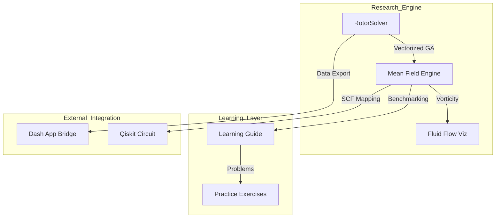

# Requirements

### Overview & Goals
The goal is to transition the `kuramoto-benchmark-suite` from a functional prototype to a comprehensive **Research & Learning Portfolio**. This involves not only completing the high-performance "Quantum Bridge" implementation but also providing deep educational resources (analytical derivations and practice problems) and advanced visualizations (Fluid Flow/Vorticity) to help the primary author master the underlying physics and mathematics.

### Scope
- **In Scope**:
    - **Educational Deliverables**: Detailed analytical derivations and practice problems in a new `LEARNING_GUIDE.md`.
    - **Advanced Visualization**: Implementation of "Fluid Flow" vorticity-based visualizations mapping bivectors to streamplots.
    - **Benchmarking & Interpretation**: Rigorous comparison between GA solvers and RK45 ground truths with explanatory commentary.
    - **Quantum Bridge**: SCF mapping of rotors to parallel quantum circuits ($O(1)$ depth).
    - **Dashboard Integration**: Data export tools to bridge results to the companion `kuramoto-dash-app`.
- **Out of Scope**: Direct modification of the `kuramoto-dash-app` repository (focus is on providing the data/scripts for integration).

### User Stories
- **As a researcher**, I want to provide cryptographic proof of my $O(1)$ quantum mapping so that I can establish prior art before publication.
- **As a student**, I want detailed notes and practice problems so that I can learn the fundamentals of Geometric Algebra and Synchronization theory.
- **As a developer**, I want a "Fluid Flow" visualization so that I can visually prove the mathematical parallel between bivector torque and fluid vorticity.
- **As an author**, I want to interpret my benchmark results clearly so that I can explain the "why" behind GA's performance advantage to my advisor.

# Technical Design

### Current Implementation
The project currently features a vectorized `RotorSolver` supporting 2D and 3D synchronization (Lohe model). It includes basic benchmarks, a Markdown-based preprint, and a visualization module (`viz.py`).

### Key Decisions
1. **Educational Deliverables Strategy**: We will shift focus from a "Preprint-first" approach to a "Learning-first" approach. We will create a `LEARNING_GUIDE.md` containing first-principles derivations and practice problems to ensure the user can primary-author the research with deep understanding.
2. **Fluid Flow Mapping**: We will use the **Bivector Vorticity** analogy. The angular velocity bivector $\Omega_i$ will be mapped to a local vorticity field, visualized via streamplots or quivers to show the "collective pull" of the mean field as a fluid-like flow.
3. **Quantum Mapping Strategy**: We will use the **Self-Consistent Field (SCF) approximation** to map non-linear Kuramoto interactions to parallel $R_z$ gates, ensuring $\mathcal{O}(1)$ circuit depth.
4. **Dash Integration**: We will implement a high-speed data export mechanism (Feather/Parquet) in the CLI to allow the `kuramoto-dash-app` to ingest simulation results without re-running long computations.

### Proposed Changes
- **`LEARNING_GUIDE.md`**: New comprehensive educational resource with derivations and problems.
- **`src/kuramoto/analysis/viz.py`**: Add `plot_fluid_vorticity` for streamplot visualizations.
- **`src/kuramoto/quantum/`**: Quantum circuit synthesis module.
- **`scripts/export_to_dash.py`**: Integration utility for the Dash app.
- **`scripts/rigorous_benchmarks.py`**: Updated with interpretation logic and comparative metrics.

### Architecture Diagram

# Testing

### Validation Approach
Verification will focus on the numerical consistency between the classical GA solver and the generated quantum circuits, as well as the educational accuracy of the learning guide.

### Key Scenarios
1. **Precision Check**: Ensure the $R_z$ gate angles generated by the `QuantumEngine` match the classical $\Omega_i \Delta t$ values to machine precision.
2. **Fluid Flow Integrity**: Verify that the vorticity streamlines correctly converge to the synchronization manifold in both 2D and 3D.
3. **Learning Verification**: Ensure practice problems have verified solutions and derivations match the "Gold Standard" implementations in the code.
4. **Dash Export Loop**: Verify that the exported data (Feather/JSON) can be successfully loaded and rendered by a mock Dash-like loader.

# Delivery Steps

### ✓ Step 1: Rigorous Benchmarking & Results Interpretation
Finalize the validation by performing a multi-dimensional sweep and providing an educational commentary on the performance vs. accuracy trade-offs.

- Create `scripts/rigorous_benchmarks.py` to sweep $N=[50, 100, 500, 1000]$ and $\Delta t$.
- Compare Vectorized GA against RK45 ground truth for long-term stability.
- Produce a `BENCHMARK_REPORT.md` that interprets these results for a non-expert audience, explaining the "Numerical Advantage" of rotors.

### ✓ Step 2: The Analytical Foundation & Fluid Flow Viz
Implement the mathematical "Bridges" through visualization and documentation.

- Create `LEARNING_GUIDE.md` containing detailed derivations of the bivector torque and its vorticity parallels.
- Implement `plot_fluid_vorticity` in `src/kuramoto/analysis/viz.py` using streamplots to visualize the ensemble flow.
- Add sources and citations for classic Kuramoto and Lohe models to the guide.

### ✓ Step 3: Fundamentals & Practice Problems
Develop the educational core of the portfolio to help the user master the subject.

- Design 10 practice problems covering Linear Algebra (rotations), GA (wedge products/rotors), and Synchronization (order parameters).
- Provide step-by-step solutions with references to the codebase (e.g., "See how this wedge product is implemented in `rotor.py`").
- Add a "Glossary of Geometric Mechanics" to the Learning Guide.

### ✓ Step 4: Quantum Bridge & Dash App Integration
Implement the high-level research deliverables and bridge to external tools.

- Create `src/kuramoto/quantum/circuit_gen.py` to implement the SCF mapping from rotors to parallel $R_z$ gates.
- Create `scripts/export_to_dash.py` to export simulation snapshots in a high-speed format (Feather/Parquet) for the `kuramoto-dash-app`.
- Document the "Dash App Bridge" protocol in `LEARNING_GUIDE.md`.