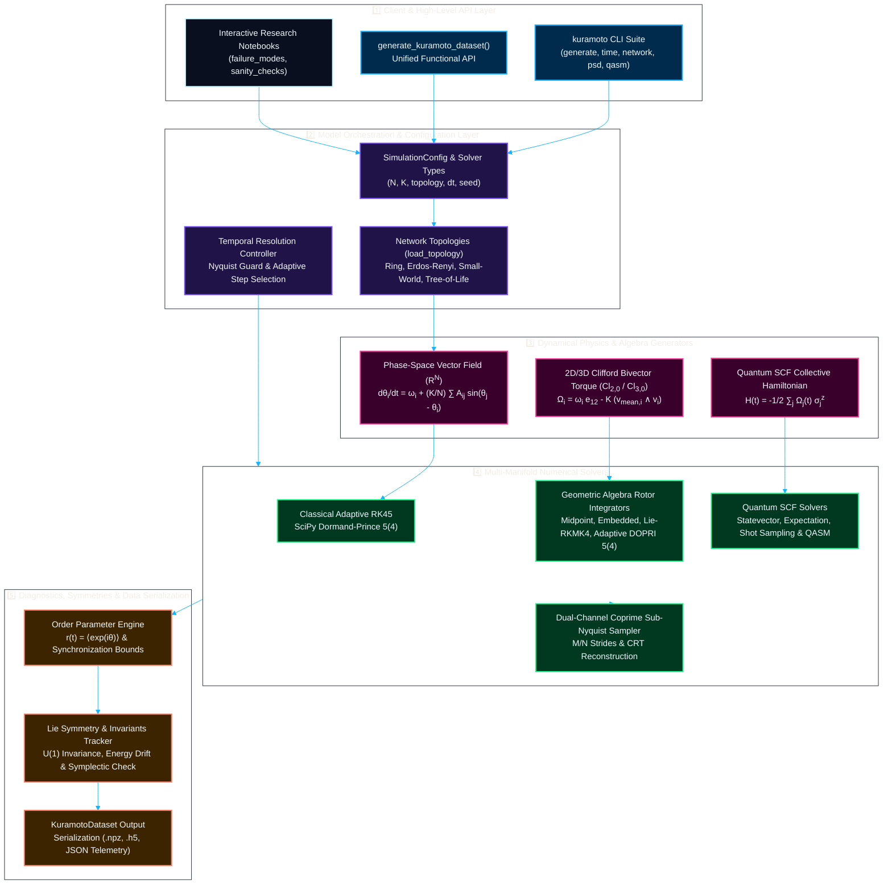

# 🔬 Kuramoto Benchmark Suite — User & Developer Guide

Welcome to the **Kuramoto Benchmark Suite**, a comprehensive, benchmark-grade scientific simulation, analysis, and visualization framework for coupled oscillator networks on complex graph topologies.

This suite unifies classical ODE integrators, **Clifford Geometric Algebra (GA)** multivector rotor solvers on $\operatorname{Spin}(2)$ / $\operatorname{Spin}(3)$, **Quantum Self-Consistent Field (SCF)** $N$-qubit Hamiltonian solvers, and **dual-channel coprime sub-Nyquist sampling**.

---

## 🏛️ 1. Architecture Overview



---

## 📦 2. Installation & Verification

### 2.1 Option A: Using `uv` (Recommended)

```bash
# Sync dependencies and development tools
uv sync --extra dev

# Verify CLI installation
uv run kuramoto --help

# Run all test suites
uv run pytest
```

### 2.2 Option B: Using Standard Python `venv` & `pip`

```bash
# Create and activate virtual environment
python3 -m venv .venv
source .venv/bin/activate  # On Windows: .venv\Scripts\activate

# Install in editable mode with development dependencies
pip install -e ".[dev]"

# Verify CLI
kuramoto --help
```

---

## 🖥️ 3. Command-Line Interface (CLI) Guide

The `kuramoto` CLI provides 11 dedicated commands for simulation, diagnostic plotting, quantum execution, and benchmarking:

```bash
kuramoto --help
```

### 3.1 Data Generation
- **`generate`**: Full parametric dataset generation with topology selection, coupling strength $K$, step size $dt$, and noise.
  ```bash
  kuramoto generate --oscillators 20 --coupling 1.5 --timesteps 1000 --dt 0.01 --topology small_world --out data/sim.npz
  ```
- **`datasetforbeginners`**: Single-command starter simulation exporting `data/examples/demo_dataset.npz`.
  ```bash
  kuramoto datasetforbeginners
  ```

### 3.2 Visual Analytics & Diagnostics
- **`time`**: Phase trajectory $\theta_i(t)$ and instantaneous frequency time series.
  ```bash
  kuramoto time --data data/examples/demo_dataset.npz --save plots/time_series.png
  ```
- **`network`**: Graph topology and phase synchronization cluster visualization.
  ```bash
  kuramoto network --data data/examples/demo_dataset.npz --save plots/network.png
  ```
- **`distributions`**: Natural frequency and initial phase distributions.
  ```bash
  kuramoto distributions --data data/examples/demo_dataset.npz --save plots/dist.png
  ```

### 3.3 Spectral & Fourier Convergence
- **`fouriervariability`**: Fourier amplitude spectrum and variability bounds across frequencies.
  ```bash
  kuramoto fouriervariability --data data/examples/demo_dataset.npz --save plots/fourier_var.png
  ```
- **`fourierconvergence`**: Time-window Fourier convergence curves.
  ```bash
  kuramoto fourierconvergence --data data/examples/demo_dataset.npz --save plots/fourier_conv.png
  ```
- **`psdvariability`**: Power Spectral Density (PSD) variability curves.
  ```bash
  kuramoto psdvariability --data data/examples/demo_dataset.npz --save plots/psd_var.png
  ```
- **`psdconvergence`**: PSD convergence against sampling frequency.
  ```bash
  kuramoto psdconvergence --data data/examples/demo_dataset.npz --save plots/psd_conv.png
  ```

### 3.4 Quantum SCF & QASM Circuit Generation
- **`quantum`**: Execute $N$-qubit Self-Consistent Field (SCF) unitary statevector simulation.
  ```bash
  kuramoto quantum --oscillators 4 --coupling 1.2 --timesteps 100 --dt 0.02 --scheme statevector
  ```
- **`qasm`**: Export parametric OpenQASM 2.0 / 3.0 quantum circuits.
  ```bash
  kuramoto qasm --oscillators 4 --coupling 1.0 --dt 0.01 --out circuits/scf_circuit.qasm
  ```

### 3.5 Rigorous Benchmarking
- **`benchmark`**: Accuracy, energy drift, and scaling comparison across Classical ODE (RK45), GA Rotors, and Euler schemes.
  ```bash
  kuramoto benchmark --oscillators 16 --timesteps 500 --dt 0.01
  ```

---

## 🐍 4. Python API Usage

### 4.1 Unified Functional API

```python
import numpy as np
from kuramoto.api import generate_kuramoto_dataset
from kuramoto.order_parameter import compute_order_parameter, track_lie_symmetries
from kuramoto.topologies import load_topology

# Generate dataset on Small-World topology
adj = load_topology("small_world", n=12, k=4, p=0.15)
omega = np.random.default_rng(42).normal(1.0, 0.2, 12)

dataset = generate_kuramoto_dataset(
    n_oscillators=12,
    natural_frequencies=omega,
    coupling=1.8,
    timesteps=200,
    dt=0.01,
    adjacency=adj,
    solver_type="rk45",
    seed=42,
)

# Compute synchronization order parameter r(t)
r = compute_order_parameter(dataset["theta"])
print(f"Final Synchronization Strength r(T) = {r[-1]:.4f}")

# Verify U(1) phase shift symmetry & Noether energy conservation
states = {f"node_{i}": dataset["theta"][:, i] for i in range(12)}
metrics = track_lie_symmetries(states, dataset["time"])
print(f"U(1) Phase Invariance: {metrics.global_phase_invariant}")
print(f"Max Energy Drift: {metrics.max_energy_drift:.2e}")
```

---

### 4.2 Clifford Geometric Algebra (GA) Rotor Solver

Evolves multivector rotors $R_i \in \operatorname{Spin}(2)$ / $\operatorname{Spin}(3)$ subject to bivector torques $\Omega_i = \omega_i e_{12} - K (v_{\text{mean},i} \wedge v_i)$:

```python
import numpy as np
from kuramoto.solvers.rotor import RotorSolver

solver = RotorSolver(n_oscillators=8, seed=42)
t_eval = np.linspace(0.0, 2.0, 100)

# Simulate using 4th-Order Lie-Group Runge-Kutta (RKMK4)
t_out, phases = solver.simulate(
    K=1.5,
    t_eval=t_eval,
    scheme="rkmk4",
    dt_internal=0.005,
)
print(f"Phases shape: {phases.shape}")  # (100, 8)
```

---

### 4.3 Quantum Self-Consistent Field (SCF) Solver

Evolves $N$-qubit product statevectors under time-dependent mean-field Hamiltonians:

```python
import numpy as np
from kuramoto.solvers.quantum_rotor import QuantumRotorSolver

q_solver = QuantumRotorSolver(n_oscillators=4, seed=42)
t_eval = np.linspace(0.0, 1.0, 50)

# Simulate exact statevector evolution
t_out, q_phases = q_solver.simulate(K=1.2, t_eval=t_eval, scheme="statevector")

# Export OpenQASM circuit
qasm_str = q_solver.to_qasm(K=1.2, dt=0.02, format_version="2.0")
print(qasm_str[:150])
```

---

### 4.4 Sub-Nyquist Coprime Sampling & CRT Reconstruction

For coherent single tones on the fine grid, dual-stride sampling with $\gcd(M,N)=1$ recovers the frequency index via CRT. The fine-grid family is $f_k = \frac{k}{MN T_S}$ for $k=0,1,\dots,MN-1$, where $T_S$ is the base integration timestep. A channel sampling every $S$ steps observes $k \bmod (MN/S)$: Channel M (stride $M$) yields $k_n=k\bmod N$, and Channel N (stride $N$) yields $k_m=k\bmod M$.

```python
from kuramoto.solvers.coprime import (
    CoprimeSamplerWrapper,
    coprime_reconstruct_frequency,
    extended_gcd,
)
from kuramoto.solvers.rotor import RotorSolver

# Verify the checked M=7, N=11 example: a=-3, b=2 and k=38.
M, N = 7, 11
k_true = 38
g, a, b = extended_gcd(M, N)
k_m = k_true % M  # Channel N's FFT peak: k mod M = 3
k_n = k_true % N  # Channel M's FFT peak: k mod N = 5
k_reconstructed = coprime_reconstruct_frequency(k_m=k_m, k_n=k_n, M=M, N=N)
assert (g, a, b) == (1, -3, 2)
assert k_reconstructed == k_true
f_k = k_true / (M * N * 0.01)  # T_S = 0.01

# Simulate dual-channel coprime sampling on GA rotor solver
solver = RotorSolver(n_oscillators=6, seed=42)
wrapper = CoprimeSamplerWrapper(solver=solver, M=M, N=N, record_phases=True)
res = wrapper.simulate(K=1.0, dt=0.01, cycles=1)

print(f"Total steps: {res.total_steps}")  # 77
print(f"Channel M samples: {len(res.t_m)}, Channel N samples: {len(res.t_n)}")
```

---

### 4.5 Dash App Telemetry Export

Export enriched JSON telemetry for interactive dashboards:

```python
from kuramoto.api import generate_kuramoto_dataset
from kuramoto.dash_export import export_for_dash

dataset = generate_kuramoto_dataset(
    n_oscillators=10,
    coupling=1.5,
    timesteps=100,
    dt=0.01,
    seed=42,
)

# Export for Dash interactive dashboard
export_for_dash(dataset, "data/dash_telemetry.json")
```

---

## 🎨 5. Frontend & Visual Styling (`the_scriber_experience`)

The benchmark suite integrates **The Scriber Experience (TSE)** frontend package located in `frontend/the_scriber_experience`:

- **CLI Semantic Palette**: Eigenscribe 256-color terminal codes (`cli_info`, `cli_success`, `cli_network`, `cli_quantum`).
- **ANSI TrueColor Gradients**: Multi-stop linear gradients (`multi_gradient`, `PRESETS`).
- **Mermaid Diagram Engine**: `the_scriber_experience.theme` generates publication-ready dark-mode architecture diagrams (`boilerplate_diagram.mmd`).
- **Matplotlib & Seaborn Bootstrap**: `the_scriber_experience.visuals` provides cyclic colormaps (`phase_cmap`) and glassmorphic dark styling.

To explore or run the standalone TSE CLI:
```bash
python -m the_scriber_experience.cli.baseline interactive
```

---

## 🧪 6. Testing & Quality Assurance

Run the test suite using `pytest`:

```bash
# Run all tests quietly
uv run pytest

# Run with verbose output
uv run pytest -v

# Run GA rotor invariant tests
uv run pytest tests/test_ga_rotor_invariants.py

# Run quantum SCF tests
uv run pytest tests/test_quantum_rotor.py

# Run coprime reconstruction tests
uv run pytest tests/test_coprime.py
```

---

## 📁 7. Repository Layout

```text
kuramoto-benchmark-suite/
├── .scriber-core/                     # Canonical Scriber Core house rules & templates (Submodule)
├── boilerplates/                      # Eigenscribe design & diagram boilerplates
│   └── mermaid/
│       └── boilerplate_diagram.mmd    # Canonical Eigenscribe Mermaid architecture blueprint
├── circuits/                          # Exported OpenQASM quantum circuits
├── data/                              # Datasets and benchmark cache (.npz, .json, .h5)
├── docs/                              # Research preprint drafts, notebooks & guides
├── frontend/
│   └── the_scriber_experience/        # The Scriber Experience (TSE) frontend & styling package
│       ├── cli/                       # Gradient engine, messaging, and baseline UI
│       ├── theme.py                   # Mermaid diagram theme engine & builder
│       ├── visuals.py                 # Matplotlib/Seaborn scientific visualization bootstrap
│       └── USER_GUIDE.md              # TSE package standalone user guide
├── notebooks/                         # Interactive verification & research notebooks
├── plots/                             # Generated publication figures
├── src/
│   └── kuramoto/                      # Core package source code
│       ├── api.py                     # Unified functional API
│       ├── model.py                   # KuramotoModel orchestration
│       ├── order_parameter.py         # Order parameters & Lie symmetries
│       ├── dash_export.py             # Dash telemetry export
│       ├── solvers/                   # Classical ODE, GA rotor, Quantum SCF, Coprime solvers
│       ├── topologies/                # Graph network topology generators
│       └── cli/                       # Click CLI command suite & styling
├── tests/                             # Automated test suite
├── pyproject.toml                     # Project dependencies and build configuration
└── USER_GUIDE.md                      # Master repository user guide (This file)
```

---

🔬 *Eigenscribe Inc. 2025-2026. Part of the Scriber Labs Research Framework.*
