# Kuramoto Benchmark Suite (v2.0) — Architecture & Integration Schemes Specification

## 1. System Overview & Architecture Diagram

The `kuramoto-benchmark-suite` (v2.0) has evolved from a single classic RK45 integrator into a multi-paradigm simulation, benchmark, and quantum emulation suite for coupled oscillator systems across Riemannian manifolds, Clifford Geometric Algebra multivector spaces, and quantum Hilbert spaces.

```mermaid
---
config:
  theme: base
  look: classic
  themeVariables:
    background: "#0D1117"
    primaryColor: "#14B5FF"
    primaryTextColor: "#F0F6FC"
    primaryBorderColor: "#14B5FF"
    lineColor: "#14B5FF"
    secondaryColor: "#0070EB"
    tertiaryColor: "#0D1117"
    fontFamily: "'Aclonica', sans-serif"
    fontSize: "15px"
    clusterBkg: "rgba(255, 255, 255, 0.03)"
    clusterBorder: "#30363D"
    edgeLabelBackground: "#0D1117"
    nodeSpacing: 45
    rankSpacing: 75
    borderRadius: "10"
  flowchart:
    curve: basis
    useMaxWidth: true
    htmlLabels: true
---
flowchart TD

subgraph Client_API["1️⃣ Client & High-Level API Layer"]
    CLI["kuramoto CLI Suite<br/>(generate, time, network, psd, fourier, qasm)"]
    Notebooks["Interactive Notebooks & Benchmarks<br/>(failure_modes, sanity_checks, quantum_sanity_checks)"]
    API_Gen["generate_kuramoto_dataset()<br/>Unified Functional API"]
    Direct_Solvers["Direct Solver Interfaces<br/>KuramotoModel / RotorSolver / QuantumRotorSolver"]
end

subgraph Model_Orchestration["2️⃣ Model Orchestration & Configuration Layer"]
    Config["SimulationConfig & Solver Types<br/>(N, K, topology, dt, seed, initial_phases, solver_type)"]
    Topology["Network Topologies (load_topology)<br/>Ring, Erdos-Renyi, Small-World, Tree-of-Life, Bipartite, Complete"]
    Temporal_Ctrl["Temporal Resolution Controller<br/>- Nyquist Criterion: dt <= 1 / (2 * max_rate)<br/>- Max Phase Increment Guard: dt <= max_Δθ / max_rate<br/>- Adaptive Error Controller: LTE <= tol"]
end

subgraph Physics_Law["3️⃣ Dynamical Physics & Algebra Generators"]
    Phase_Physics["Phase-Space Vector Field (R^N)<br/>dθ_i/dt = ω_i + (K/N) ∑ A_ij sin(θ_j - θ_i)"]
    GA_2D_Physics["2D Clifford Bivector Torque (Cl_2,0)<br/>Ω_i = ω_i e12 - K (v_mean,i ∧ v_i)<br/>dR_i/dt = -1/2 Ω_i R_i"]
    GA_3D_Physics["3D Spin(3) Lohe Matrix/Bivector Torque (Cl_3,0)<br/>Ω_i = Ω_nat,i - K (v_mean,i ∧ v_i)"]
    Quantum_Physics["Quantum SCF Collective Hamiltonian<br/>H(t) = -1/2 ∑_j Ω_j(t) σ_j^z<br/>Unitary Evolution: U(dt) = ⨂_j R_Z(Ω_j dt)"]
end

subgraph State_Representations["4️⃣ Multi-Manifold State Representations"]
    PhaseState["Phase Vector: θ ∈ R^N<br/>Canonical phase angles"]
    RotorArray["Contiguous Rotor Array Buffer (_rotor_array)<br/>- 2D Cl(2): [scalar, e12] components<br/>- 3D Cl(3): [scalar, e12, e13, e23] components<br/>Fast SIMD/NumPy Vectorized State"]
    RotorState["Clifford Rotor Objects (R_i ∈ Spin(n))<br/>Multivector Objects: R_i = exp(-B θ_i / 2)"]
    QuantumState["Quantum N-Qubit Statevector<br/>|ψ⟩ = ⨂_j (cos(θ_j/2)|0⟩ + sin(θ_j/2)|1⟩)"]
    Sync["Bidirectional Manifold Synchronizer<br/>_sync_array_from_rotors() ⟷ _sync_rotors_from_array()"]
end

subgraph Integrator_Ecosystem["5️⃣ Comprehensive Numerical Integration Schemes"]
    subgraph Classic_Scheme["A. Classical Phase-Space Integrator"]
        RK45_Int["Adaptive RK45 (solve_kuramoto)<br/>SciPy Dormand-Prince 5(4) with continuous interpolant"]
    end

    subgraph Explicit_GA_Schemes["B. First-Order & Mean-Field Rotor Integrators"]
        Vec_Euler["Vectorized GA Euler (step_euler_vectorized_geometric)<br/>Pure NumPy bivector torque step on rotor buffer"]
        Geom_Euler["Clifford Multivector Euler (step_euler_geometric)<br/>Direct object-level GA rotor update"]
        Fast_Euler["Fast Mean-Field Euler (step_euler_fast)<br/>O(N) all-to-all complex order parameter acceleration"]
        Std_Euler["Standard Pairwise Euler (step_euler)<br/>Phase-space difference stepping"]
    end

    subgraph Higher_Order_GA_Schemes["C. Geometric & Lie-Group Integrators"]
        Midpoint_Geom["2nd-Order Geometric Midpoint (step_midpoint_geometric)<br/>2-stage predictor-corrector on Spin(n)"]
        Pred_Corr["Embedded Predictor-Corrector (step_predictor_corrector)<br/>Heun/Midpoint embedded stages with LTE estimation"]
        Lie_RKMK4["4th-Order Lie-Group RKMK4 (step_rkmk4)<br/>Runge-Kutta-Munthe-Kaas O(dt^4) exact Lie evolution"]
        DOPRI54_Geom["Adaptive DOPRI 5(4) (step_adaptive_dopri54)<br/>7-stage Dormand-Prince Lie stepper with FSAL & PI step control"]
        Adaptive_Emb["Adaptive Embedded Stepper (step_adaptive_embedded)<br/>Automatic dt adjustment with LTE error tolerances"]
    end

    subgraph Quantum_SCF_Schemes["D. Quantum Self-Consistent Field (SCF) Solvers"]
        Q_Statevector["Quantum Statevector Mode (statevector)<br/>Exact unitary evolution U = exp(-i H dt)"]
        Q_Expectation["Quantum Expectation Mode (expectation)<br/>Analytical Pauli X, Y, Z observable evaluation"]
        Q_ShotSampling["Quantum Shot Sampling Mode (shot_sampling)<br/>Projective measurement with stochastic hardware shot noise"]
        QASM_Gen["OpenQASM 2.0 / 3.0 Exporter (to_qasm)<br/>Exportable parametric quantum circuits"]
    end
end

subgraph Diagnostics_Layer["6️⃣ Observables, Symmetries & Diagnostics Layer"]
    Obs_Phase["Phase Extraction & Unwrapping Engine<br/>extract_phases(): θ_i = 2 atan2(-b, a) mod 2π"]
    Obs_OP["Order Parameter Engine<br/>- Complex order parameter: r(t) = ⟨exp(iθ)⟩<br/>- Vector order parameter: ⟨v_i⟩ on S^(dim-1)<br/>- Synchronization strength: ||r|| or ||⟨v⟩||"]
    Obs_Lie["Lie Symmetry & Invariants Tracker<br/>- U(1) Phase Shift Invariance: d/dα L = 0<br/>- Noether Energy Drift / Hamiltonian Invariant<br/>- Contraction Rate / Symplectic Inversion Check"]
    Obs_Spectral["Spectral Analytics Engine<br/>- Fourier amplitude spectrum & convergence<br/>- Power Spectral Density (PSD) variability"]
    Dataset_Out["KuramotoDataset (Immutable Output Container)<br/>Serialization (.npz, .h5, JSON analytics)"]
end

%% Client & Routing
Client_API --> Config
Client_API --> Direct_Solvers
Config --> Model_Orchestration
Topology --> Physics_Law
Temporal_Ctrl --> Integrator_Ecosystem

%% Model to State & Physics
Model_Orchestration -->|"Initializes state"| State_Representations
RotorState <--> Sync
Sync <--> RotorArray

%% Physics to Integrator Mapping
Phase_Physics --> Classic_Scheme
GA_2D_Physics --> Explicit_GA_Schemes
GA_2D_Physics --> Higher_Order_GA_Schemes
GA_3D_Physics --> Higher_Order_GA_Schemes
Quantum_Physics --> Quantum_SCF_Schemes

%% State to Integrator Mapping
PhaseState --> RK45_Int
PhaseState --> Std_Euler
PhaseState --> Fast_Euler
RotorArray --> Vec_Euler
RotorArray --> Midpoint_Geom
RotorArray --> Pred_Corr
RotorArray --> Lie_RKMK4
RotorArray --> DOPRI54_Geom
RotorArray --> Adaptive_Emb
RotorState --> Geom_Euler
QuantumState --> Q_Statevector
QuantumState --> Q_Expectation
QuantumState --> Q_ShotSampling
QuantumState --> QASM_Gen

%% Integrator state updates
Integrator_Ecosystem -->|"Advances state along manifold"| State_Representations

%% State to Diagnostics
State_Representations --> Diagnostics_Layer
RotorArray --> Obs_Phase
RotorState --> Obs_OP
PhaseState --> Obs_OP
QuantumState --> Obs_Phase
QuantumState --> Obs_OP
Diagnostics_Layer --> Obs_Lie
Diagnostics_Layer --> Obs_Spectral
Diagnostics_Layer --> Dataset_Out
```



---

## 2. Taxonomy of Numerical Integration Schemes

The suite organizes numerical integrators into four distinct operational paradigms:

### Paradigm A: Classical Phase-Space Integrator (`rk45`)
- **Module**: `kuramoto.solvers.rk45` (`solve_kuramoto`)
- **Manifold**: Flat Phase Space $\theta \in \mathbb{R}^N$
- **RHS Formulation**:
  $$\frac{d\theta_i}{dt} = \omega_i + \frac{K}{N}\sum_{j=1}^N A_{ij}\sin(\theta_j - \theta_i)$$
- **Stepping Mechanism**: Adaptive Runge-Kutta Dormand-Prince 5(4) via `scipy.integrate.solve_ivp`.
- **Characteristics**: High numerical accuracy for phase-only dynamics; susceptible to phase wrap discontinuities and coordinate singularities without Lie algebra preservation.

---

### Paradigm B: Explicit & Mean-Field GA Rotor Solvers
- **Module**: `kuramoto.solvers.rotor` (`RotorSolver`)
- **Manifold**: Spin Group $\operatorname{Spin}(2) \cong U(1)$ or $\operatorname{Spin}(3) \cong SU(2)$
- **Bivector Generator**: $\Omega_i = \omega_i e_{12} - K (v_{\text{mean},i} \wedge v_i)$, $\dot{R}_i = -\frac{1}{2}\Omega_i R_i$
- **Schemes**:
  1. `vectorized_geometric` (`rotor`): Fast vectorized Euler stepping on contiguous `_rotor_array` memory buffers $[a_i, b_i]$ with exact rotor exponential update $R_i(t+\Delta t) = \exp(-\frac{1}{2}\Omega_i \Delta t) R_i(t)$.
  2. `euler_geometric` (`geometric`): Object-level multivector Clifford algebra stepping with geometric wedge products.
  3. `euler_fast` (`fast`): Mean-field acceleration computing the complex order parameter $r = \frac{1}{N}\sum_j e^{i\theta_j}$ in $O(N)$ operations for dense/all-to-all topologies instead of $O(N^2)$ pairwise loops.
  4. `euler_standard` (`standard`): Standard phase-space Euler stepping.

---

### Paradigm C: Geometric, Higher-Order & Adaptive Lie-Group Integrators
- **Module**: `kuramoto.solvers.rotor` (`RotorSolver`)
- **Manifold**: Lie Group $\operatorname{Spin}(n)$ preserved to machine precision without numerical drift off the sphere.
- **Schemes**:
  1. `midpoint_geometric` (`midpoint`): 2nd-order geometric midpoint predictor-corrector. Evaluates half-step torque $\Omega_{1/2}$ and applies full-step exponential update on $\operatorname{Spin}(n)$.
  2. `predictor_corrector` (`pc`): Embedded Heun/Midpoint scheme that simultaneously calculates a 2nd-order predicted state and 3rd-order corrected state to estimate Local Truncation Error (LTE).
  3. `rkmk4` (`geometric_rk4`): 4th-order Runge-Kutta-Munthe-Kaas Lie-group integrator. Computes 4 Lie-algebra stages $k_1, k_2, k_3, k_4 \in \mathfrak{spin}(n)$, maps through the dexp inverse series, and advances via group exponential map with $O(\Delta t^4)$ local convergence.
  4. `adaptive_dopri54` (`dopri54`): 7-stage embedded Dormand-Prince 5(4) Lie-group integrator featuring the First-Same-As-Last (FSAL) property, local error estimation $\text{LTE} = \|R^{(5)} - R^{(4)}\|$, and automatic time-step adaptation with PI controllers.
  5. `adaptive_embedded` (`adaptive`): Embedded adaptive time stepper with configurable `adaptive_rtol`, `adaptive_atol`, `dt_min`, and `dt_max`.

---

### Paradigm D: Quantum Self-Consistent Field (SCF) Solvers
- **Module**: `kuramoto.solvers.quantum_rotor` (`QuantumRotorSolver`, `step_quantum_scf`)
- **State Space**: $N$-qubit Hilbert space $(\mathbb{C}^2)^{\otimes N}$, $|\psi\rangle = \bigotimes_{j=1}^N \left(\cos\frac{\theta_j}{2}|0\rangle + \sin\frac{\theta_j}{2}|1\rangle\right)$
- **Mean-Field Generator**:
  $$\Omega_j(t) = \omega_j + \frac{K}{N}\sum_k A_{jk}\sin(\theta_k - \theta_j)$$
  $$H(t) = -\frac{1}{2}\sum_{j=1}^N \Omega_j(t)\sigma_j^z, \quad U(\Delta t) = \bigotimes_{j=1}^N R_Z(\Omega_j \Delta t)$$
- **Execution Modes**:
  1. `statevector`: Exact unitary statevector propagation ($U^\dagger U = \mathbb{I}$) with machine-precision time reversibility.
  2. `expectation`: Analytical Pauli observable extraction $\langle \sigma^x \rangle = \sin\theta_j$, $\langle \sigma^z \rangle = \cos\theta_j$.
  3. `shot_sampling`: Statistical projective shot sampling on quantum registers simulating real NISQ/QPU measurement noise ($N_{\text{shots}}$).
  4. `to_qasm()`: OpenQASM 2.0 / 3.0 circuit serialization supporting Clifford+Rz synthesis and hardware execution.

---

## 3. Observables, Invariants & Diagnostics Architecture

The diagnostics pipeline (`kuramoto.metrics.analytics_engine`, `kuramoto.order_parameter`, `kuramoto.analysis.spectral`) extracts structural physics metrics across all integration schemes:
- **Order Parameters**: $r(t) = \left|\frac{1}{N}\sum_j e^{i\theta_j}\right|$, vector order parameter $\langle v \rangle \in S^{n-1}$, and coupling susceptibility $\chi = N(\langle r^2 \rangle - \langle r \rangle^2)$.
- **Lie Symmetry Invariance**: Continuous phase rotation symmetry tracking $\mathcal{L}_\alpha \theta_j = (\theta_j + \alpha) \pmod{2\pi}$ demonstrating Noether current conservation.
- **Symplectic Inversion / Reversibility**: Time-reversal residual test comparing forward-backward step recovery ($\Delta t \to -\Delta t$).
- **Spectral PSD & Fourier Analysis**: FFT amplitude spectra, power spectral density (Welch method), and peak frequency convergence.

---

## 4. API & Integration Contract for Dashboard (Dash / Plotly)

All solvers conform to the unified signature:
```python
dataset = generate_kuramoto_dataset(
    n_oscillators=N,
    coupling=K,
    topology="ring" | "erdos_renyi" | "small_world" | "tree_of_life" | "complete",
    solver_type="rk45" | "vectorized_geometric" | "rkmk4" | "dopri54" | "midpoint" | "quantum_statevector" | "shot_sampling",
    timesteps=1000,
    dt=0.01,
    seed=42,
)
```
Outputs standard immutable `KuramotoDataset` with `.theta`, `.dtheta`, `.time`, `.omega`, and `.order_parameter`.
